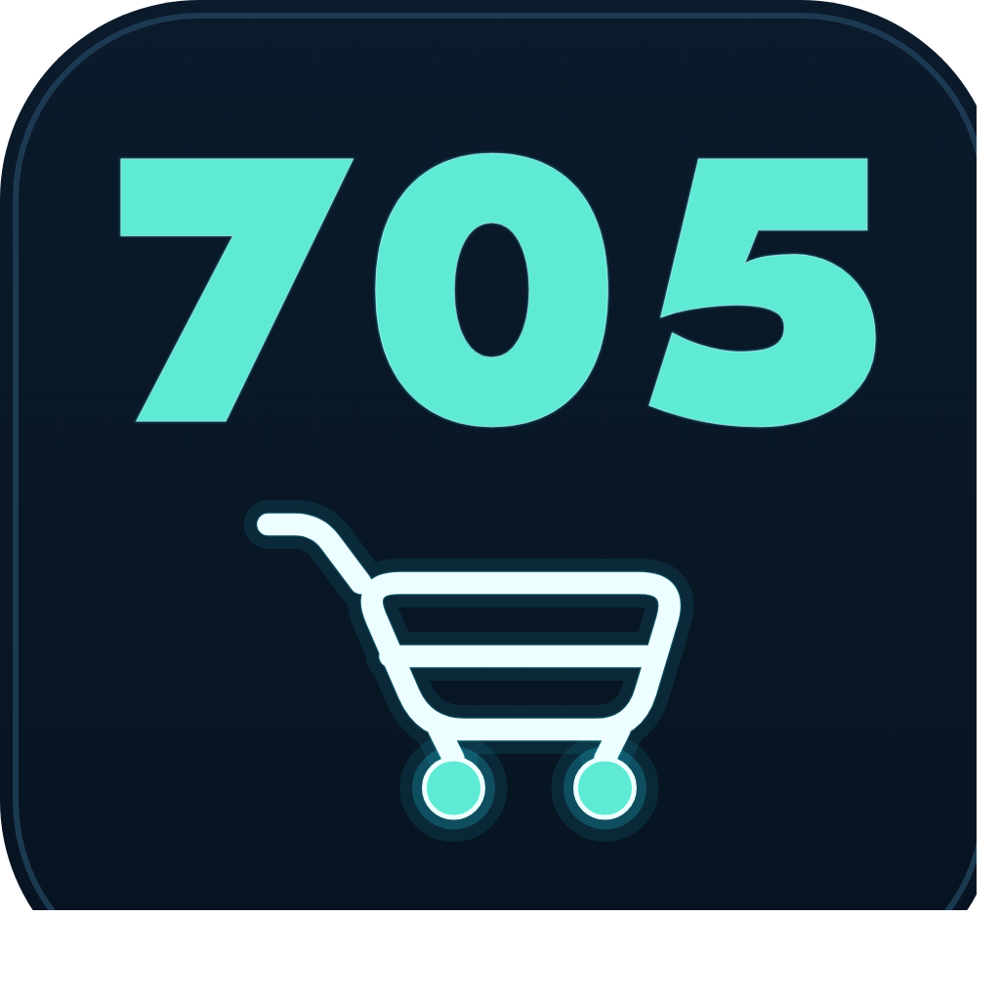

<p align="center">
  
</p>

<h1 align="center">BachHoa705</h1>

<p align="center">
  A Telegram-first point-of-sale system for a Vietnamese grocery shop —
  desktop app, static storefront, and ordering bot sharing one database,
  running at zero hosting cost.
</p>

<p align="center">
  <a href="README.md">Tiếng Việt</a> ·
  <a href="README.ru.md">Русский</a> ·
  <a href="LICENSE"></a>
</p>

---

Built for a Vietnamese grocery shop (candy, rice, instant noodles, coffee,
spices…) serving the Vietnamese community in Saint Petersburg, Russia, with
prices in RUB. The owner manages cost prices, customers, invoices, debt, and
profit from a desktop app; customers browse prices and place orders through a
static website or a Telegram bot.

## Architecture

```
Desktop app (Windows, PySide6)  ──┬──  source of truth: cost prices,
  cost prices / invoices / debt    │    customers, invoices, debt, profit
                                   │
                                   ├──▶ Static website (GitHub Pages)
                                   │    public prices, order placement —
                                   │    never shows cost or debt data
                                   │
                                   └──▶ Telegram bot (Cloudflare Workers)
                                        receives orders, forwards them to
                                        the app, notifies each customer when
                                        their order has arrived
```

The desktop app is the **only** place that writes real data. The website and
bot only **read** the published public price feed
(`shop.tools.export_public`) — neither ever writes back to the database.

## Features

- **Catalog & cost pricing** — Russian-convention rounding, price history,
  per-customer markup.
- **Customer & supplier invoices** — draft/finalize/cancel, Excel export with
  live formulas, reading supplier invoice photos with a local vision model
  (Ollama, free, nothing leaves the machine).
- **Debt & profit tracking** — computed per customer; a finalized invoice's
  numbers never silently drift if a cost price changes afterward.
- **Static storefront** — accent-insensitive search, category browsing, dark
  mode, hosted free on GitHub Pages.
- **Telegram bot (Cloudflare Workers)** — orders via a Mini App or a plain
  web link, two-way sync with the desktop app, per-customer "your order has
  arrived" notifications.
- **Automatic backup & restore** — a snapshot on every app launch, one-click
  restore, no command line required.

## Tech stack

| Component | Technology |
|---|---|
| Desktop app | Python 3.13, PySide6 (Qt), SQLite, openpyxl |
| Python environment | [uv](https://astral.sh/uv) |
| Telegram bot | JavaScript, Cloudflare Workers (serverless, free tier) |
| Website | Plain HTML/CSS/JS, no framework, GitHub Pages |
| Invoice-photo reading | [Ollama](https://ollama.com) + `qwen2.5vl:7b` (runs locally) |
| Packaging | PyInstaller (Windows/macOS) |

## Download and use the app (no coding required)

1. Grab the latest packaged build from this repo's
   [Releases](https://github.com/Friendzoner49/705bot/releases) page —
   `BachHoa705-windows.zip` for Windows or the `.dmg` for macOS. No
   Python/uv install needed.
2. Windows: unzip and run `BachHoa705.exe`. macOS: open the `.dmg` and drag
   the app into Applications (the first launch will be blocked since it
   isn't notarized — go to System Settings → Privacy & Security → "Open
   Anyway").
3. On first launch the app creates an **empty** database on your own
   machine — it never touches the original shop's real data. Import your
   own catalog via "Nhập danh mục từ Excel…" (Catalog tab), or try it
   instantly with `docs/sample_data/demo_catalog.xlsx` (entirely fictional
   data).
4. For a full walkthrough of every tab (customers, invoices, debt/profit,
   backups…), see [`docs/HUONG_DAN_SU_DUNG.md`](docs/HUONG_DAN_SU_DUNG.md)
   (Vietnamese only for now).

The app runs **standalone** — no network connection needed for the
catalog/customer/invoice management on your own machine. If you'd also like
the **public website** or the **Telegram ordering bot**, like the live demo
this project runs (you'd need your own Cloudflare/GitHub Pages accounts —
see [`bot/README.md`](bot/README.md) to self-host), message
**[@BachHoa705_bot](https://t.me/BachHoa705_bot)** on Telegram for help
connecting.

## Quick start (for reading/modifying the code)

```bash
git clone https://github.com/Friendzoner49/705bot.git
cd 705bot
uv sync
uv run pytest -q          # 179 tests, no real data required
uv run shop-app            # launches the app (creates an empty database on first run)
```

Try importing a sample catalog (entirely fictional data, not real business
data):

```bash
uv run python -m shop.tools.import_xlsx docs/sample_data/demo_catalog.xlsx
```

The Telegram bot runs on Cloudflare Workers — see
[`bot/README.md`](bot/README.md) for the one-time deployment steps.

## Project layout

```
src/shop/
├── core/        # pure-Python business logic (no Qt dependency, unit-tested)
├── db/          # SQLite schema + migrations
├── ocr/         # reading supplier invoices with a local vision model
├── excel/       # Excel export
├── ui/          # PySide6 UI
└── tools/       # import/export scripts
bot/             # Telegram bot — a separate Node.js project on Cloudflare Workers
tests/           # pytest suite for the core/UI layers
docs/            # usage guide, sample data
```

## License

[MIT](LICENSE).

## A note on the code comments

Many code comments still reference `CLAUDE.md` — an internal development
decision log kept out of this public repository because it contains real
business data. Those references are historical notes only; they don't affect
reading or running the code.
