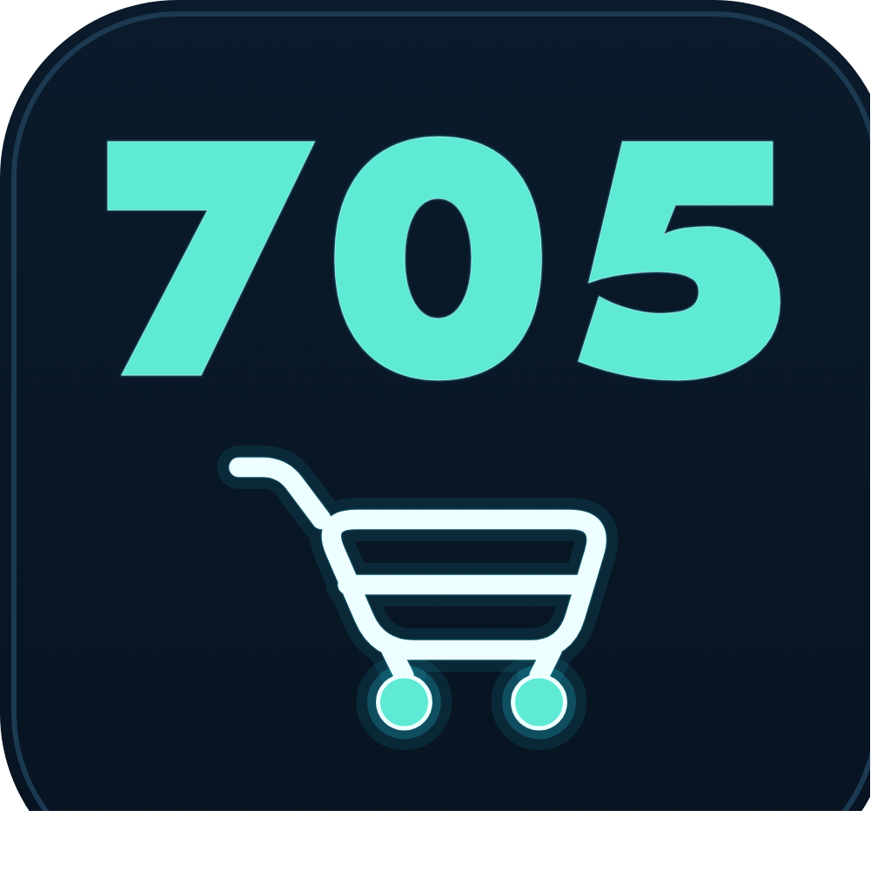

<p align="center">
  
</p>

<h1 align="center">BachHoa705</h1>

<p align="center">
  Hệ thống bán hàng tạp hóa Việt Nam qua Telegram — app quản lý desktop,
  website tĩnh và bot đặt hàng, dùng chung 1 cơ sở dữ liệu, chi phí vận hành
  bằng 0 đồng.
</p>

<p align="center">
  <a href="README.en.md">English</a> ·
  <a href="README.ru.md">Русский</a> ·
  <a href="LICENSE"></a>
</p>

---

Dự án được xây cho một cửa hàng tạp hóa Việt Nam (bánh kẹo, gạo, mì, cà phê,
gia vị…) bán cho cộng đồng người Việt tại Saint Petersburg, Nga, thanh toán
bằng RUB. Chủ cửa hàng dùng app desktop để quản lý giá vốn, khách hàng, hóa
đơn, công nợ và lợi nhuận; khách hàng xem giá và đặt hàng qua website hoặc bot
Telegram.

## Kiến trúc

```
App desktop (Windows, PySide6)  ──┬──  sổ sách gốc: giá vốn, khách hàng,
  quản lý giá vốn/hóa đơn/công nợ  │    hóa đơn, công nợ, lợi nhuận
                                   │
                                   ├──▶ Website tĩnh (GitHub Pages)
                                   │    khách xem giá công khai, đặt hàng —
                                   │    không có giá vốn/công nợ
                                   │
                                   └──▶ Bot Telegram (Cloudflare Workers)
                                        nhận đơn, gửi về app theo định dạng
                                        cố định, báo "hàng đã về" từng khách
```

App là nơi **duy nhất** ghi dữ liệu thật. Website và bot chỉ **đọc** giá công
khai đã xuất ra (`shop.tools.export_public`) — không bao giờ ghi ngược vào cơ
sở dữ liệu.

## Tính năng chính

- **Quản lý danh mục & giá vốn** — làm tròn giá theo quy ước Nga, lịch sử giá,
  markup riêng theo từng khách hàng.
- **Hóa đơn khách & nhà cung cấp** — nháp/hoàn tất/hủy, xuất Excel kèm công
  thức, đọc bảng hàng từ ảnh hóa đơn bằng AI thị giác cục bộ (Ollama, miễn
  phí, không gửi ảnh ra ngoài).
- **Công nợ & lợi nhuận** — tính theo từng khách, không đổi ngược khi giá vốn
  thay đổi sau khi hóa đơn đã hoàn tất.
- **Website tĩnh** — tìm kiếm không dấu, lọc theo nhóm hàng, chế độ tối, chạy
  trên GitHub Pages, chi phí 0 đồng.
- **Bot Telegram (Cloudflare Workers)** — nhận đơn qua Mini App hoặc link
  web, đồng bộ hai chiều với app, thông báo "hàng đã về" riêng từng khách.
- **Sao lưu & khôi phục tự động** — snapshot mỗi lần mở app, khôi phục bằng 1
  nút bấm, không cần thao tác dòng lệnh.

## Công nghệ

| Thành phần | Công nghệ |
|---|---|
| App quản lý | Python 3.13, PySide6 (Qt), SQLite, openpyxl |
| Quản lý môi trường Python | [uv](https://astral.sh/uv) |
| Bot Telegram | JavaScript, Cloudflare Workers (serverless, miễn phí) |
| Website | HTML/CSS/JS thuần, không framework, GitHub Pages |
| Đọc hóa đơn bằng AI | [Ollama](https://ollama.com) + `qwen2.5vl:7b` (chạy cục bộ) |
| Đóng gói | PyInstaller (Windows/macOS) |

## Tải và sử dụng app (không cần biết lập trình)

1. Vào mục [Releases](https://github.com/Friendzoner49/705bot/releases) của
   repo này, tải bản đóng gói sẵn mới nhất cho Windows
   (`BachHoa705-windows.zip`) hoặc macOS (`.dmg`) — không cần cài Python/uv.
2. Windows: giải nén rồi chạy `BachHoa705.exe`. macOS: mở file `.dmg`, kéo
   app vào Applications (lần đầu mở sẽ bị chặn vì chưa notarize — vào Cài
   đặt hệ thống → Quyền riêng tư & Bảo mật → "Vẫn mở").
3. Lần đầu mở, app tự tạo 1 cơ sở dữ liệu **rỗng** trên máy bạn — không đụng
   gì đến dữ liệu thật của cửa hàng gốc. Nhập danh mục của riêng bạn bằng nút
   "Nhập danh mục từ Excel…" (tab Danh mục hàng), hoặc dùng thử ngay với
   `docs/sample_data/demo_catalog.xlsx` (dữ liệu hoàn toàn hư cấu).
4. Hướng dẫn dùng từng tab trong app (thêm khách hàng, tạo hóa đơn, xem công
   nợ/lợi nhuận, sao lưu…): xem
   [`docs/HUONG_DAN_SU_DUNG.md`](docs/HUONG_DAN_SU_DUNG.md).

App chạy **độc lập**, không cần kết nối gì để dùng phần quản lý giá
vốn/khách hàng/hóa đơn trên máy bạn. Muốn dùng thêm **website công khai**
hoặc **bot Telegram nhận đơn** như bản demo đang chạy thật (cần tài khoản
Cloudflare/GitHub Pages riêng, xem [`bot/README.md`](bot/README.md) để tự
triển khai), nhắn tin cho **[@BachHoa705_bot](https://t.me/BachHoa705_bot)**
trên Telegram để được hỗ trợ kết nối.

## Bắt đầu nhanh (cho người muốn đọc/sửa code)

```bash
git clone https://github.com/Friendzoner49/705bot.git
cd 705bot
uv sync
uv run pytest -q          # 179 test, không cần dữ liệu thật
uv run shop-app            # mở app (tạo database rỗng ở lần chạy đầu)
```

Thử nhập 1 danh mục mẫu (dữ liệu hoàn toàn hư cấu, không phải dữ liệu kinh
doanh thật):

```bash
uv run python -m shop.tools.import_xlsx docs/sample_data/demo_catalog.xlsx
```

Bot Telegram chạy trên Cloudflare Workers — xem hướng dẫn triển khai 1 lần
tại [`bot/README.md`](bot/README.md).

## Cấu trúc thư mục

```
src/shop/
├── core/        # nghiệp vụ thuần Python (không phụ thuộc Qt, test được)
├── db/          # schema + migration SQLite
├── ocr/         # đọc hóa đơn NCC bằng AI thị giác cục bộ
├── excel/       # xuất Excel
├── ui/          # giao diện PySide6
└── tools/       # script nhập/xuất dữ liệu
bot/             # bot Telegram — project Node.js riêng, chạy trên Cloudflare Workers
tests/           # pytest cho phần core/UI
docs/            # hướng dẫn sử dụng, dữ liệu mẫu
```

## Giấy phép

[MIT](LICENSE).

## Một lưu ý khi đọc code

Phần lớn chú thích trong code vẫn còn tham chiếu đến `CLAUDE.md` — nhật ký
quyết định kỹ thuật dùng nội bộ khi phát triển (chứa dữ liệu kinh doanh thật
nên không public cùng repo). Tham chiếu đó chỉ là ghi chú lịch sử, không ảnh
hưởng gì đến việc đọc hiểu hay chạy code.
