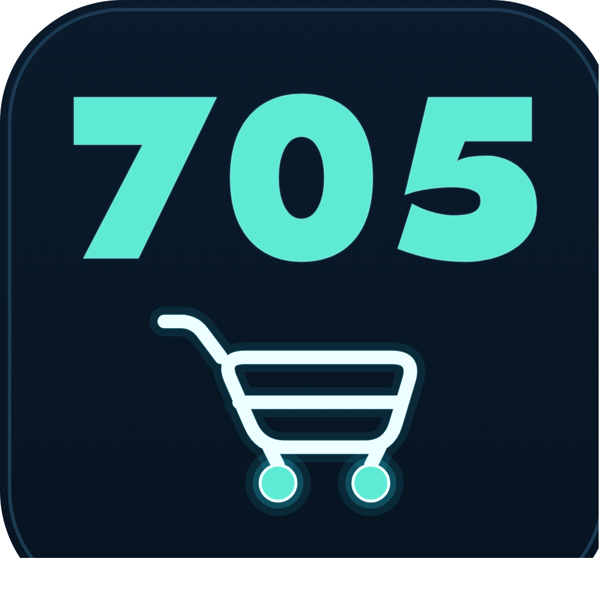

<p align="center">
  
</p>

<h1 align="center">BachHoa705</h1>

<p align="center">
  Система учёта и приёма заказов для вьетнамского продуктового магазина —
  десктоп-приложение, статичный сайт-витрина и бот в Telegram работают с
  одной базой данных, без расходов на хостинг.
</p>

<p align="center">
  <a href="README.md">Tiếng Việt</a> ·
  <a href="README.en.md">English</a> ·
  <a href="LICENSE"></a>
</p>

---

Проект создан для вьетнамского продуктового магазина (конфеты, рис, лапша
быстрого приготовления, кофе, специи…), который обслуживает вьетнамскую
общину в Санкт-Петербурге; цены указаны в рублях. Владелец ведёт
себестоимость, клиентов, счета, долги и прибыль через десктоп-приложение;
покупатели смотрят цены и оформляют заказы через сайт или Telegram-бота.

## Архитектура

```
Десктоп-приложение (Windows, PySide6)  ──┬── источник истины: себестоимость,
  себестоимость / счета / долги          │   клиенты, счета, долги, прибыль
                                         │
                                         ├──▶ Статичный сайт (GitHub Pages)
                                         │    публичные цены, оформление
                                         │    заказа — без себестоимости и
                                         │    долгов
                                         │
                                         └──▶ Telegram-бот (Cloudflare Workers)
                                              принимает заказы, передаёт их
                                              в приложение, уведомляет
                                              каждого клиента о поступлении
                                              товара
```

Десктоп-приложение — **единственное** место, где данные реально
записываются. Сайт и бот только **читают** опубликованный прайс-лист
(`shop.tools.export_public`) и никогда не пишут обратно в базу данных.

## Основные возможности

- **Каталог и себестоимость** — округление по российскому правилу, история
  цен, индивидуальная наценка для каждого клиента.
- **Счета клиентам и поставщикам** — черновик/завершение/отмена, экспорт в
  Excel с формулами, распознавание товарных позиций на фото накладной
  локальной моделью компьютерного зрения (Ollama, бесплатно, фото никуда не
  уходит).
- **Учёт долгов и прибыли** — считается по каждому клиенту; цифры
  завершённого счёта не меняются задним числом при изменении себестоимости.
- **Статичный сайт-витрина** — поиск без учёта диакритики, категории,
  тёмная тема, бесплатный хостинг на GitHub Pages.
- **Telegram-бот (Cloudflare Workers)** — заказ через Mini App или обычную
  ссылку, двусторонняя синхронизация с приложением, персональные уведомления
  «ваш заказ поступил».
- **Автоматическое резервное копирование** — снимок при каждом запуске
  приложения, восстановление одной кнопкой, без командной строки.

## Технологии

| Компонент | Технология |
|---|---|
| Десктоп-приложение | Python 3.13, PySide6 (Qt), SQLite, openpyxl |
| Управление Python-окружением | [uv](https://astral.sh/uv) |
| Telegram-бот | JavaScript, Cloudflare Workers (serverless, бесплатный тариф) |
| Сайт | Чистые HTML/CSS/JS, без фреймворков, GitHub Pages |
| Распознавание накладных | [Ollama](https://ollama.com) + `qwen2.5vl:7b` (работает локально) |
| Сборка дистрибутива | PyInstaller (Windows/macOS) |

## Скачать и начать пользоваться приложением (без программирования)

1. Откройте раздел [Releases](https://github.com/Friendzoner49/705bot/releases)
   этого репозитория и скачайте последнюю готовую сборку — архив
   `BachHoa705-windows.zip` для Windows или `.dmg` для macOS. Python/uv
   устанавливать не нужно.
2. Windows: распакуйте архив и запустите `BachHoa705.exe`. macOS: откройте
   `.dmg` и перетащите приложение в Applications (при первом запуске
   система заблокирует его как ненотаризованное — откройте Настройки
   системы → Конфиденциальность и безопасность → «Всё равно открыть»).
3. При первом запуске приложение создаёт **пустую** базу данных прямо на
   вашем компьютере — реальные данные исходного магазина оно не трогает.
   Импортируйте свой каталог через «Nhập danh mục từ Excel…» (вкладка
   каталога) или попробуйте сразу с `docs/sample_data/demo_catalog.xlsx`
   (полностью вымышленные данные).
4. Подробное руководство по каждой вкладке (клиенты, счета, долги/прибыль,
   резервные копии…): [`docs/HUONG_DAN_SU_DUNG.md`](docs/HUONG_DAN_SU_DUNG.md)
   (пока только на вьетнамском).

Приложение работает **автономно** — для учёта себестоимости, клиентов и
счетов на своём компьютере интернет не нужен. Если хотите подключить ещё и
**публичный сайт** или **Telegram-бота** для приёма заказов, как в реальной
демо-версии этого проекта (понадобятся собственные аккаунты Cloudflare и
GitHub Pages — инструкция по самостоятельному развёртыванию в
[`bot/README.md`](bot/README.md)), напишите
**[@BachHoa705_bot](https://t.me/BachHoa705_bot)** в Telegram — помогут
подключить.

## Быстрый старт (для чтения/изменения кода)

```bash
git clone https://github.com/Friendzoner49/705bot.git
cd 705bot
uv sync
uv run pytest -q          # 179 тестов, реальные данные не нужны
uv run shop-app            # запускает приложение (при первом запуске создаёт пустую базу)
```

Попробуйте импортировать демонстрационный каталог (полностью вымышленные
данные, не реальные данные магазина):

```bash
uv run python -m shop.tools.import_xlsx docs/sample_data/demo_catalog.xlsx
```

Telegram-бот работает на Cloudflare Workers — шаги разового развёртывания
описаны в [`bot/README.md`](bot/README.md).

## Структура проекта

```
src/shop/
├── core/        # бизнес-логика на чистом Python (без Qt, покрыта тестами)
├── db/          # схема и миграции SQLite
├── ocr/         # распознавание накладных поставщиков локальной моделью
├── excel/       # экспорт в Excel
├── ui/          # интерфейс на PySide6
└── tools/       # скрипты импорта/экспорта
bot/             # Telegram-бот — отдельный проект на Node.js, Cloudflare Workers
tests/           # тесты pytest для core/UI
docs/            # руководство пользователя, демонстрационные данные
```

## Лицензия

[MIT](LICENSE).

## Примечание о комментариях в коде

Многие комментарии в коде всё ещё ссылаются на `CLAUDE.md` — внутренний
журнал решений разработки, который не включён в этот публичный репозиторий,
так как содержит реальные бизнес-данные. Эти ссылки — лишь историческая
справка и никак не влияют на чтение или запуск кода.
